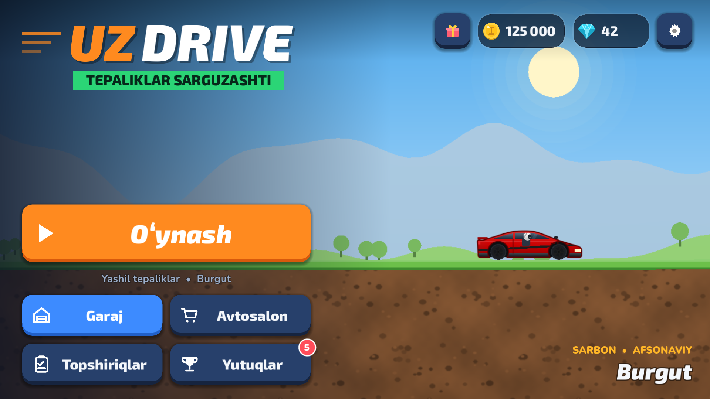
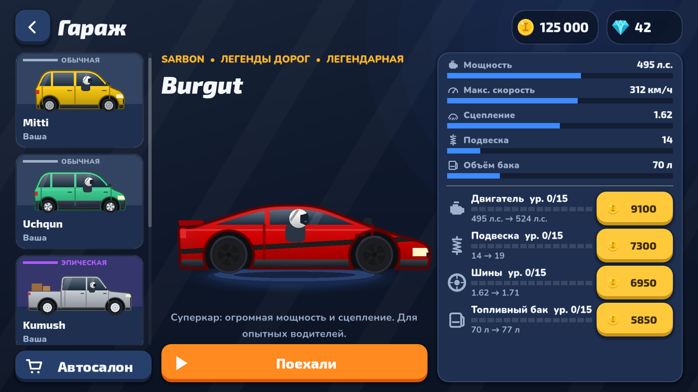
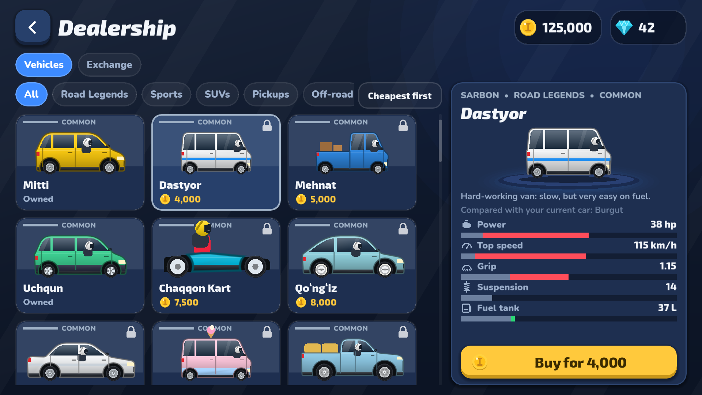
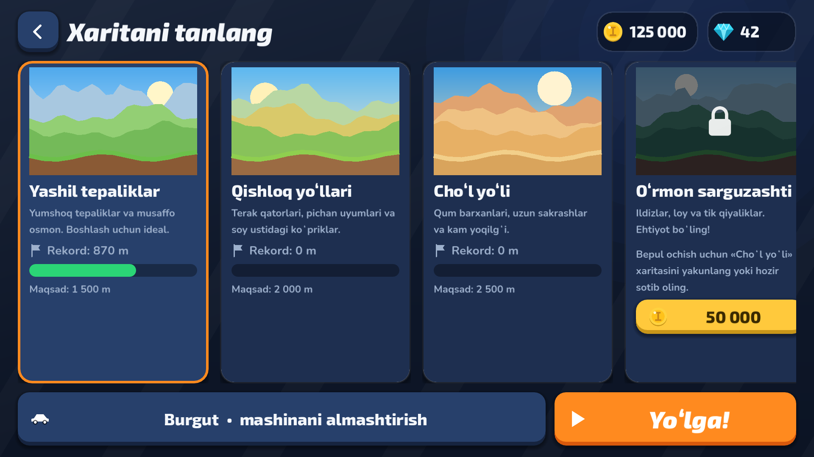
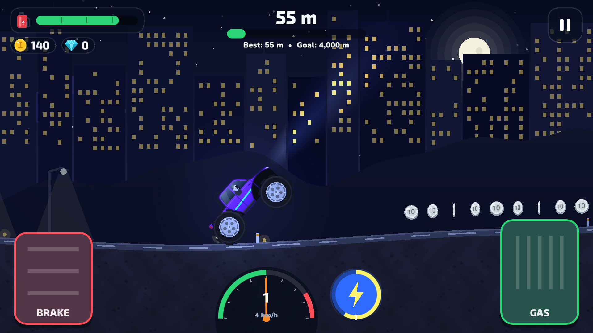

# UZ Drive: Hill Adventure

A 2D physics-based hill-climb driving game for Android and iOS, built with **Godot 4.7 (GDScript)**.
Drive 61 original vehicles across 8 hand-tuned environments, collect coins and fuel, pull off flips, upgrade engine / suspension / tires / fuel tank, and unlock the whole garage — in **Uzbek (default), Russian and English**.



| | |
|---|---|
|  |  |
|  |  |

## Features
* **Physics driving:** rigid-body chassis with shape-cast suspension, traction limited by grip × load, FWD/RWD/AWD, engine torque curve with gears, air control, flips, wheelies, crashes.
* **61 vehicles** in 8 categories (Road Legends — original GM-inspired designs — plus sports, SUVs, pickups, off-road, classics, special incl. monster truck/tractor/bus/lunar rover, and fictional premium cars), 4 rarities, each with unique procedural artwork, stats, sound and upgrade potential. No real brands or logos; licensing-ready data structure.
* **Garage & dealership:** browse, filter by category, sort, compare against your car, confirmed purchases, live showroom preview.
* **4 upgrade tracks** that change the real physics; costs scale per level.
* **8 environments:** Green Hills, Countryside, Desert Road, Forest Adventure, City Roads, Snow Mountains, Rocky Mountains, Night Highway — each with its own terrain grammar, surfaces (mud, sand, ice, wet asphalt), obstacles, parallax art, weather and lighting.
* **Economy:** coins 5–500, distance/checkpoint/trick bonuses, daily login, daily missions, 15 tiered achievements, gems (earned only by playing), gem revive, gem→coin exchange. No real-money purchases, no loot boxes.
* **Fuel & boost** systems, tutorial, pause, results with payout breakdown.
* **Crash-safe saves** (atomic, checksummed, backup, interrupted-run recovery), cloud-sync ready.
* **Original generated audio** (engine loops per engine type, SFX, 3 music tracks) and art.

## Run it
1. Install [Godot 4.7.2](https://godotengine.org/download) (standard build).
2. Open `project.godot` in the editor and press **Play** — or from a terminal:
   ```
   godot --path .
   ```
   Desktop keys: →/D gas, ←/A brake, Space boost, Esc pause.

Browser demo: `godot --headless --path . --export-release "Web" build/web/uzdrive.html && python3 tools/web/build_demo.py` (see docs/RELEASE.md → Web demo).

## Test it
```
godot --headless --path . --import
godot --headless --fixed-fps 60 --path . -s tests/run_tests.gd                      # 45 tests
godot --headless --fixed-fps 60 --path . -s tools/dev/fleet_sim.gd -- green_hills 40 0   # drive all 61 cars
```

## Project layout
```
src/autoload   services: Events, DB, Save, Profile, Loc, Economy, Progress, Audio, Services, UI
src/core       constants, utilities, VehicleSpec (stats+upgrades), UpgradeRules
src/gameplay   GameScreen (run rules), vehicle/ (physics + procedural art), world/ (terrain, backdrop, pickups), hud/
src/ui         design-system widgets and menu screens
data/          vehicles, environments, economy, missions, achievements, i18n (all content is data)
tools/         generators (vehicles, maps, i18n, audio, textures, icons), QA bots, version bump
tests/         automated test-suite
docs/          architecture, design, economy, QA, release, store listing, privacy, licences
```

## Documentation
* [Architecture](docs/ARCHITECTURE.md) · [Game design](docs/GAME_DESIGN.md) · [Vehicle catalogue](docs/VEHICLES.md) · [Economy](docs/ECONOMY.md)
* [QA report](docs/QA_REPORT.md) · [Release & store preparation](docs/RELEASE.md) · [Store listing](docs/STORE_LISTING.md) · [Privacy policy](docs/PRIVACY_POLICY.md) · [Licences](docs/LICENSES.md) · [Development log](docs/DEVELOPMENT_LOG.md)

## Status
Feature-complete and build-ready. **Not published** — store submission requires the steps in [docs/RELEASE.md](docs/RELEASE.md) (signing keys, Android SDK / Xcode builds, device testing, store consoles).
